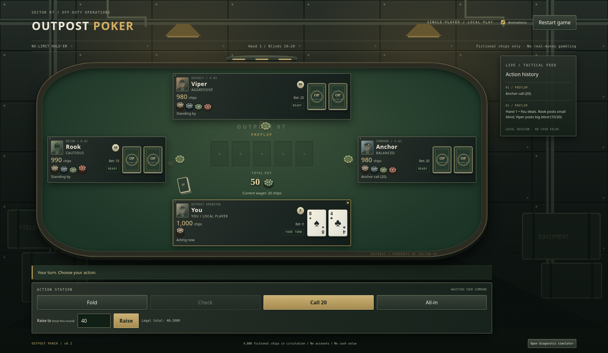

# Outpost Poker

An original single-player military-themed Texas Hold’em game for Windows browsers. One human faces three computer opponents using fictional chips only. No real-money gambling, backend, database, account, Unity or Unreal Engine is used.

**Current status (v0.2):** playable single-player no-limit Hold’em in an original military bunker environment. Face cautious Rook, aggressive Viper and balanced Anchor, with automatic opponent turns and a tested independent rules engine.

## Requirements
Node.js 22.12 or newer and npm. Node 24 is recommended. Use a modern Windows browser such as Edge, Chrome or Firefox.

## Install and launch
From the project directory:

```sh
npm ci
npm run dev
```

Open the address printed by Vite in your browser, normally `http://localhost:5173`. Stop the server with Ctrl+C. On Windows these commands work in PowerShell from the repository folder. If PowerShell blocks `npm.ps1`, use `npm.cmd ci` and `npm.cmd run dev` without changing execution policy. Keep the server window open while playing; when done, close the game tab and press Ctrl+C in that window (or close the window). Installed Node.js and idle project files do not themselves run a background game process. If npm's cache is unwritable, use `npm ci --cache <writable-cache-directory>`.

## Checks and production build

```sh
npm run test
npm run typecheck
npm run build
```

`npm run check` runs the tests and production build together. `npm run test:watch` watches tests. Production output goes to `dist/`. To inspect that output locally, run `npm run preview` and open Vite's printed address. Preview is for local verification.

## Project map
- `src/poker`: deck, evaluation, betting state machine, pots and independent engine API.
- `src/state`: playable session, public action history and card visibility.
- `src/ai`: profiles, sampled equity and distinct legal decision policies.
- `src/ui`: playable table, betting controls, cards, animations and optional diagnostic simulator.
- `src/assets`: original CSS bunker/felt textures and asset provenance.

Read [GAME_DESIGN.md](GAME_DESIGN.md), [ARCHITECTURE.md](ARCHITECTURE.md), [ROADMAP.md](ROADMAP.md), and [AGENTS.md](AGENTS.md) before development. The frontend has relative build assets and isolated domain modules to support a future Windows wrapper. No desktop package exists yet.

The GitHub repository currently retains its `Military-Poker-Game` repository name; the application is named **Outpost Poker**.

## How to play

1. Run `npm run dev` and open the address Vite prints. A new game deals automatically: you and three opponents start with 1,000 fictional chips each; blinds are 10/20.
2. Your cards appear at the bottom. The highlighted seat and turn banner show who acts. Wait for automatic opponent turns; controls unlock when it is your turn.
3. Choose **Fold**, **Check**, **Call**, or **All-in**. For **Bet/Raise**, enter your total contribution for the current betting round (not the extra chips to add). The displayed legal range and disabled controls prevent invalid wagers.
4. The engine progresses through flop, turn, river and showdown. When you fold or go all-in, remaining opponents continue automatically. Opponents reveal only non-folded showdown hands.
5. Read the after-action report for pot awards/refunds and the tactical feed for public actions. Click **New hand** to continue with the remaining stacks.
6. If you lose your stack or win all the chips, click **Play again**. **Restart game** resets the session at any time. Refreshing also resets play; there is no saved game yet.

The UI uses original CSS textures and fictional identity placeholders. Animated card dealing respects reduced-motion preferences. Windows desktop browsers are the intended platform; narrow layouts also adapt. All chips have no monetary value.

## Diagnostics and validation

**Open diagnostic simulator** opens a separate developer sandbox with all cards visible and manual control of all seats; it does not expose or alter the active single-player game's cards. Read ARCHITECTURE.md for the standalone engine API and GAME_DESIGN.md for precise rule conventions.

`npm run check` runs the entire automated suite and production build. Tests cover rules, payouts, privacy, AI policies, complete sessions, human betting controls, scheduling, reset and elimination. The AI is a sampled-equity heuristic, not a professional solver. Manual Windows Edge/Firefox, screen-reader/keyboard, animation comfort and gameplay-balance verification remain outstanding. No audio, persistence, statistics, alternative modes or desktop installer is implemented.

## Current QA status

The stability pass passed **88 tests**, TypeScript and the production build. The suite includes **1,464 complete-hand simulations** (1,306 starting with four funded seats), 100 real-opponent-policy hands and category counts for every possible five-card hand. npm audit reported zero known vulnerabilities. Automated Chromium checks passed on development and production builds. See [QA_REPORT.md](QA_REPORT.md) for fixes, coverage counters and remaining manual checks.

No major features or visual changes were added. A downloaded ZIP does not automatically receive GitHub updates; download the latest version or pull changes in a Git checkout to use this QA patch.

## v0.2 visual upgrade



The game now has an original SVG bunker, illustrated military portrait placeholders, a stitched table rail, tactile cards, denomination chip stacks and modular tactical panels. The **Animations** checkbox controls only cosmetic effects; system reduced-motion settings take precedence. All poker rules, AI policies and session behavior are preserved. No new dependency is needed.

The current visual build passes **99 tests**, TypeScript and production build. Chromium checks passed at 1366×768, 1920×1080, 2560×1440, 1024×768 and 390×844, plus full 22-hand sessions on development/production. See [VISUAL_DESIGN.md](VISUAL_DESIGN.md) for module/asset details, limitations and next priorities. Native Windows, display scaling and human accessibility/comfort verification remain outstanding.

Download/extract the latest GitHub ZIP or pull updates, then run `npm.cmd ci` and `npm.cmd run dev` from the folder containing package.json. Keep the terminal open and visit the printed Local address. Stop with Ctrl+C when done.
